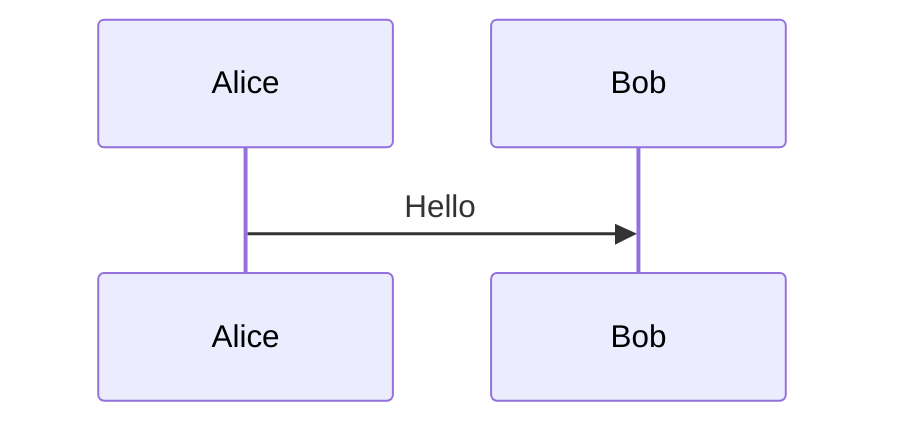

# Graal native-image releases Implementation Plan

> **For agentic workers:** REQUIRED SUB-SKILL: Use superpowers:subagent-driven-development (recommended) or superpowers:executing-plans to implement this plan task-by-task. Steps use checkbox (`- [ ]`) syntax for tracking.

**Goal:** Publish GraalVM native images of the `atbp` CLI for Linux x86_64, Linux aarch64, and macOS Apple Silicon on GitHub Releases, next to the existing Java 25 universal zip.

**Architecture:** `md2c` gains an offline renderer that parses the markdown files directly in one directory and runs the existing PlantUML, Mermaid, and D2 transforms, writing one png per diagram kind. The CLI exposes that as `md2c --render-only`. The native image is the same main class, with sbt's `version` baked in as `ph.samson.atbp.version`, and a shell smoke script is the release gate. CI stays generated from `github.sbt`: a `native` job builds the image on three runners after `build`, and `release` attaches the zip plus the three binaries.

**Tech Stack:** Scala 3.9.0, sbt 1.13.0, sbt-native-packager 1.12.0 (`GraalVMNativeImagePlugin`), sbt-github-actions 0.32.1, GraalVM Community JDK 25, ZIO 2.1.26, zio-cli 0.8.2, mermaid-java 0.3.0-beta.2 (GraalJS 25.3.4.1 via `Context.newBuilder("js")`), d2 `v0.9.0`.

## Global Constraints

- The universal zip stays. `build` and `publish` stay as they are. `sbt installLocal` stays a JVM install.
- Linux binaries are dynamically linked against glibc. No `--static`, no `--libc=musl`, no Alpine.
- No macOS code signing or notarization.
- Native images are not built on pull requests. The `native` job runs only when the event is not a pull request and the ref is `main` or a `v*` tag.
- Do not move to a larger GitHub-hosted runner. If a hosted runner runs out of memory, that is a later change. Do not raise the native-image heap past `-J-Xmx6g`.
- `d2` and Graphviz stay programs on `PATH`. They are not bundled in the binary, the zip, or the image.
- Do not publish the native binaries to Maven or GHCR.
- CI stays generated from `github.sbt`. Do not hand-edit `.github/workflows/ci.yml`. Regenerate it with `githubWorkflowGenerate`.
- Leave `graalVMNativeImageGraalVersion` unset. Do not build inside the plugin's Graal Docker image.
- `graalVMNativeImageOptions` starts as `--no-fallback` and `-J-Xmx6g`. Add further flags only when the build or the smoke suite requires them.
- The image name is `atbp`. CI renames it to the platform asset name only at upload time.
- The native job overrides `SBT_OPTS` to `-Xmx2G`.
- Each native cell has a 90-minute timeout. The matrix fails fast.
- On `main`, a green smoke test is the end of the native job. Do not upload artifacts on `main`.
- A missing release asset, a `(dev)` version, a missing image file, and the smoke script's failure text are hard failures. The production `md2c` publish path still soft-fails a single bad diagram.
- Existing JVM test suites stay the coverage for command behavior. They are not re-run inside the native image.
- Local sbt commands use `sbt --client`. Never run interactive sbt (`console`, `~compile`, bare `sbt`).
- Before every commit that touches Scala, `build.sbt`, or `project/`, run the fixup loop in that task's commit step. A successful `fixup` exit alone is not done; `git status` must be clean for the files in that commit.

## File structure

- `cli/src/main/scala/ph/samson/atbp/cli/Main.scala` — version string: native system property, then JAR implementation version, then `(dev)`. `atbp --version` prints it. zio-cli 0.8.2 has no version built-in, so `Main.run` handles that single argument.
- `md2c/src/main/scala/ph/samson/atbp/md2c/OfflineRender.scala` — parse non-dot `*.md` in one directory, run the three transforms, write `plantuml.png`, `mermaid.png`, and `d2.png`.
- `md2c/src/test/scala/ph/samson/atbp/md2c/OfflineRenderSpec.scala` — empty directory, nested markdown, duplicate fences, a fence that does not produce an image.
- `cli/src/main/scala/ph/samson/atbp/cli/Markdown2Confluence.scala` — `--render-only` and `--target`. Publish is unchanged.
- `cli/src/test/scala/ph/samson/atbp/cli/VersionSpec.scala` — the three version cases.
- `cli/src/test/scala/ph/samson/atbp/cli/Markdown2ConfluenceRenderOnlySpec.scala` — the three images, absent failure strings, no Confluence config, and `--render-only` with `--cleanup`.
- `project/Dependencies.scala` — zio-test on `cli`, so those specs run. sbt 1.13 already lists `TestFrameworks.ZIOTest` in the default frameworks; do not add `testFrameworks` again.
- `cli/native-smoke/smoke.sh` — release gate. Takes the binary path and the expected version.
- `cli/native-smoke/fixtures/note.md`, `hello.pdf`, `diagrams/diagrams.md` — smoke inputs.
- `build.sbt` — enable `GraalVMNativeImagePlugin` on `cli` and set the image name and options.
- `cli/src/main/resources/META-INF/native-image/reachability-metadata.json` — tracing-agent output. CI does not run the agent.
- `github.sbt` — `native` job and the release script that attaches four files. Regenerates `.github/workflows/ci.yml`.
- `README.md` — packaged-releases section lists the zip and the three binaries.

`GraalVMNativeImage / packageBin` uses `name` in the `GraalVMNativeImage` config, which otherwise falls through to the project name `atbp-cli`. Set `GraalVMNativeImage / name := "atbp"`. The existing `packageName := "atbp"` only names the universal zip. `JavaAppPackaging` already resolves `Compile / mainClass` to `ph.samson.atbp.cli.Main`; do not set `mainClass` again.

---

### Task 1: Version string

**Files:**
- Create: `cli/src/test/scala/ph/samson/atbp/cli/VersionSpec.scala`
- Modify: `cli/src/main/scala/ph/samson/atbp/cli/Main.scala`
- Modify: `project/Dependencies.scala` (the `cli` library-dependency list)

**Interfaces:**
- Consumes: nothing
- Produces: `ph.samson.atbp.cli.Main.versionString(nativeVersion: Option[String], implementationVersion: Option[String]): String`
  - non-empty `nativeVersion` wins, printed as `v` plus that string
  - otherwise a non-empty `implementationVersion`, printed the same way
  - otherwise `(dev)`
  - `Main.Version` calls it with `sys.props.get("ph.samson.atbp.version")` and `Option(Main.getClass.getPackage.getImplementationVersion)`
  - `atbp --version` prints `Main.Version` and exits 0. zio-cli 0.8.2 does not implement `--version` (`BuiltInOption` still says "TODO add built-in option to show version"), and a parent option with no subcommand is turned into help by `Subcommands.parse`. Intercept that one argument in `Main.run` before `cliApp.run`.

- [ ] **Step 1: Add the test dependency and the failing test**

In `project/Dependencies.scala`, extend the `cli` dependency list so it ends with the test libraries already used by `md2c`:

```scala
  val cli = libraryDependencies ++= Seq(
    basedir,
    pprint,
    zioCli,
    zioConfig,
    zioConfigMagnolia,
    zioConfigTypesafe,
    zioLogging,
    TestLibs.slf4jSimple,
    TestLibs.zioLogging,
    TestLibs.zioLoggingSlf4j2,
    TestLibs.zioTest,
    TestLibs.zioTestMagnolia,
    TestLibs.zioTestSbt
  )
```

Create `cli/src/test/scala/ph/samson/atbp/cli/VersionSpec.scala`:

```scala
package ph.samson.atbp.cli

import zio.test.*

object VersionSpec extends ZIOSpecDefault {

  override def spec = suite("versionString")(
    test("native property wins and gains a v prefix") {
      assertTrue(
        Main.versionString(Some("1.2.3"), Some("9.9.9")) == "v1.2.3",
        Main.versionString(Some("0.0.0+3-abcd"), None) == "v0.0.0+3-abcd"
      )
    },
    test("empty native property falls through to the jar version") {
      assertTrue(
        Main.versionString(Some(""), Some("1.2.3")) == "v1.2.3",
        Main.versionString(None, Some("1.2.3")) == "v1.2.3"
      )
    },
    test("neither source prints (dev)") {
      assertTrue(
        Main.versionString(None, None) == "(dev)",
        Main.versionString(Some(""), Some("")) == "(dev)",
        Main.versionString(None, Some("")) == "(dev)"
      )
    }
  )
}
```

- [ ] **Step 2: Run the test to verify it fails**

Run: `sbt --client "cli/testOnly *VersionSpec*"`

Expected: FAIL. `versionString` is not a member of `Main`.

- [ ] **Step 3: Implement the selection**

In `cli/src/main/scala/ph/samson/atbp/cli/Main.scala`, replace the `Version` block with:

```scala
  def versionString(
      nativeVersion: Option[String],
      implementationVersion: Option[String]
  ): String =
    nativeVersion
      .filter(_.nonEmpty)
      .orElse(implementationVersion.filter(_.nonEmpty))
      .map(v => s"v$v")
      .getOrElse("(dev)")

  val Version = versionString(
    sys.props.get("ph.samson.atbp.version"),
    Option(Main.getClass.getPackage.getImplementationVersion)
  )
```

Add `import zio.Console` and `import zio.ZIOAppArgs` to the imports. Override `run` so the single argument `--version` prints `Version` to stdout and does not load config or require a subcommand. Keep the parse-error exit from `ZIOCli.run` for every other argument list:

```scala
  override def run =
    for {
      args <- ZIOAppArgs.getArgs
      result <-
        if (args == zio.Chunk.single("--version")) {
          Console.printLine(Version).as(ExitCode.success)
        } else {
          cliApp.run(args.toList).catchSome {
            case CliError.Parsing(_) =>
              exit(ExitCode.failure)
          }
        }
    } yield result
```

Add `import zio.cli.CliError`. sbt's `version` has no leading `v`; the `v` is added in `versionString`. An empty property is absent for this purpose, so the universal zip still prints the JAR implementation version. `atbp --help` is not this branch, so help stays the zio-cli built-in.

- [ ] **Step 4: Run the test to verify it passes**

Run: `sbt --client "cli/testOnly *VersionSpec*"`

Expected: PASS, three tests.

- [ ] **Step 5: Commit**

`project/Dependencies.scala` is under `project/`, so this commit uses `sbt --batch` for fixup.

```bash
git add cli/src/main/scala/ph/samson/atbp/cli/Main.scala \
  cli/src/test/scala/ph/samson/atbp/cli/VersionSpec.scala \
  project/Dependencies.scala
sbt --batch fixup && git status
```

If `git status` still shows modified or untracked files that belong in this commit, `git add` them and run `sbt --batch fixup && git status` again. Commit only when fixup succeeded and that status is clean:

```bash
git add cli/src/main/scala/ph/samson/atbp/cli/Main.scala \
  cli/src/test/scala/ph/samson/atbp/cli/VersionSpec.scala \
  project/Dependencies.scala
git commit -m "$(cat <<'EOF'
feat: prefer the native-image version property over the jar manifest

EOF
)"
```

---

### Task 2: Offline diagram render

**Files:**
- Create: `md2c/src/main/scala/ph/samson/atbp/md2c/OfflineRender.scala`
- Create: `md2c/src/test/scala/ph/samson/atbp/md2c/OfflineRenderSpec.scala`

**Interfaces:**
- Consumes: `Parser.parse(source: File): Task[Parsed]`, `PlantUml.transform`, `Mermaid.transform`, `D2.transform`. Transform order matches `StagedTree.convert`: PlantUML, then Mermaid, then D2. Do not call `SourceTree`, `Extensions`, or anything that builds a Confluence client.
- Produces: `ph.samson.atbp.md2c.OfflineRender.render(sourceDir: File, targetDir: File): zio.Task[Unit]`
  - Considers only regular files whose names end in `.md` and do not start with `.`, directly in `sourceDir`. Not recursive.
  - Zero such files is `IllegalArgumentException` whose message contains `no markdown files`.
  - A second fence whose language starts with the same kind (`plantuml`, `mermaid`, or `d2`) is `IllegalArgumentException` whose message contains `multiple plantuml`, `multiple mermaid`, or `multiple d2`.
  - Writes `targetDir / "plantuml.png"`, `mermaid.png`, and `d2.png` for each kind that was present, copied from the transform's non-empty temp file (suffixes `.plantuml.png`, `.mermaid.png`, `.d2.png`).
  - A fence that leaves its `CodeBlock` in place, or that does not leave a non-empty png, is `IllegalArgumentException`. A leftover Mermaid block's message contains `Mermaid rendering failed`. Publish behavior is unchanged: `Mermaid.transform` and `D2.transform` still soft-fail.

- [ ] **Step 1: Write the failing test**

Create `md2c/src/test/scala/ph/samson/atbp/md2c/OfflineRenderSpec.scala`:

```scala
package ph.samson.atbp.md2c

import better.files.File
import zio.ZIO
import zio.test.*

object OfflineRenderSpec extends ZIOSpecDefault {

  private def dirWith(files: (String, String)*): ZIO[Any, Throwable, File] =
    ZIO.attemptBlocking {
      val dir = File.newTemporaryDirectory("offline-render")
      files.foreach { (name, body) =>
        val file = dir / name
        file.parent.createDirectoryIfNotExists(createParents = true)
        file.writeText(body)
      }
      dir
    }

  private val onePlantUml =
    """```plantuml
      |Alice -> Bob: hello
      |```
      |""".stripMargin

  private val twoPlantUml =
    s"""$onePlantUml
       |
       |$onePlantUml
       |""".stripMargin

  private val invalidMermaid =
    """```mermaid
      |invalid!!!
      |```
      |""".stripMargin

  override def spec = suite("OfflineRender")(
    test("a directory with no markdown files fails") {
      for {
        source <- dirWith("notes.txt" -> "nope")
        target <- ZIO.attemptBlocking(File.newTemporaryDirectory("offline-out"))
        error <- OfflineRender.render(source, target).flip
      } yield assertTrue(
        error.isInstanceOf[IllegalArgumentException],
        error.getMessage.contains("no markdown files")
      )
    },
    test("markdown nested in a subdirectory does not count") {
      for {
        source <- dirWith("nested/page.md" -> onePlantUml)
        target <- ZIO.attemptBlocking(File.newTemporaryDirectory("offline-out"))
        error <- OfflineRender.render(source, target).flip
      } yield assertTrue(error.getMessage.contains("no markdown files"))
    },
    test("a dotfile markdown is ignored") {
      for {
        source <- dirWith(".hidden.md" -> onePlantUml)
        target <- ZIO.attemptBlocking(File.newTemporaryDirectory("offline-out"))
        error <- OfflineRender.render(source, target).flip
      } yield assertTrue(error.getMessage.contains("no markdown files"))
    },
    test("a second fence of the same kind fails") {
      for {
        source <- dirWith("a.md" -> twoPlantUml)
        target <- ZIO.attemptBlocking(File.newTemporaryDirectory("offline-out"))
        error <- OfflineRender.render(source, target).flip
      } yield assertTrue(
        error.isInstanceOf[IllegalArgumentException],
        error.getMessage.contains("multiple plantuml")
      )
    },
    test("the same kind split across two files fails") {
      for {
        source <- dirWith(
          "a.md" -> onePlantUml,
          "b.md" -> onePlantUml
        )
        target <- ZIO.attemptBlocking(File.newTemporaryDirectory("offline-out"))
        error <- OfflineRender.render(source, target).flip
      } yield assertTrue(error.getMessage.contains("multiple plantuml"))
    },
    test("a mermaid fence that does not render fails") {
      for {
        source <- dirWith("bad.md" -> invalidMermaid)
        target <- ZIO.attemptBlocking(File.newTemporaryDirectory("offline-out"))
        error <- OfflineRender.render(source, target).flip
      } yield assertTrue(
        error.isInstanceOf[IllegalArgumentException],
        error.getMessage.contains("Mermaid rendering failed"),
        !(target / "mermaid.png").exists
      )
    }
  )
}
```

- [ ] **Step 2: Run the test to verify it fails**

Run: `sbt --client "md2c/testOnly *OfflineRenderSpec*"`

Expected: FAIL. `OfflineRender` is not found.

- [ ] **Step 3: Implement OfflineRender**

Create `md2c/src/main/scala/ph/samson/atbp/md2c/OfflineRender.scala`:

```scala
package ph.samson.atbp.md2c

import better.files.File
import com.atlassian.adf.model.node.CodeBlock
import com.atlassian.adf.model.node.Doc
import com.atlassian.adf.model.node.Media.ExternalMedia
import zio.Task
import zio.ZIO

import scala.jdk.StreamConverters.*

object OfflineRender {

  val ImageNames: Map[String, String] = Map(
    "plantuml" -> "plantuml.png",
    "mermaid" -> "mermaid.png",
    "d2" -> "d2.png"
  )

  private val tempSuffix: Map[String, String] = Map(
    "plantuml" -> ".plantuml.png",
    "mermaid" -> ".mermaid.png",
    "d2" -> ".d2.png"
  )

  def render(sourceDir: File, targetDir: File): Task[Unit] =
    for {
      files <- markdownFiles(sourceDir)
      _ <- ZIO.when(files.isEmpty)(
        ZIO.fail(
          new IllegalArgumentException(
            s"no markdown files in ${sourceDir.path}"
          )
        )
      )
      parsed <- ZIO.foreach(files)(Parser.parse)
      fences = parsed.flatMap(p => diagramFences(p.doc))
      _ <- rejectDuplicateKinds(fences)
      rendered <- ZIO.foreach(parsed.map(_.doc))(transform)
      _ <- ZIO.attemptBlocking(
        targetDir.createDirectoryIfNotExists(createParents = true)
      )
      kinds = fences.map(_.kind).distinct
      _ <- ZIO.foreachDiscard(kinds) { kind =>
        copyKind(rendered, kind, targetDir / ImageNames(kind))
      }
    } yield ()

  private case class Fence(kind: String, language: String)

  private def markdownFiles(sourceDir: File): Task[List[File]] =
    ZIO.attemptBlocking {
      sourceDir.list
        .filter { file =>
          file.isRegularFile &&
          file.name.endsWith(".md") &&
          !file.name.startsWith(".")
        }
        .toList
        .sortBy(_.name)
    }

  private def kindOf(language: String): Option[String] =
    if (language.startsWith("plantuml")) Some("plantuml")
    else if (language.startsWith("mermaid")) Some("mermaid")
    else if (language.startsWith("d2")) Some("d2")
    else None

  private def diagramFences(doc: Doc): List[Fence] =
    doc
      .allNodesOfType(classOf[CodeBlock])
      .toScala(List)
      .flatMap { block =>
        kindOf(block.language().orElse("")).map { kind =>
          Fence(kind, block.language().orElse(""))
        }
      }

  private def rejectDuplicateKinds(fences: List[Fence]): Task[Unit] =
    ZIO.foreachDiscard(fences.groupBy(_.kind)) { case (kind, items) =>
      ZIO.when(items.size > 1)(
        ZIO.fail(
          new IllegalArgumentException(
            s"multiple $kind fences; --render-only writes one ${ImageNames(kind)}"
          )
        )
      )
    }

  private def transform(doc: Doc): Task[Doc] =
    for {
      plant <- PlantUml.transform(doc)
      mermaid <- Mermaid.transform(plant)
      d2 <- D2.transform(mermaid)
    } yield d2

  private def copyKind(docs: List[Doc], kind: String, dest: File): Task[Unit] =
    for {
      leftovers <- ZIO.succeed(
        docs.flatMap { doc =>
          doc
            .allNodesOfType(classOf[CodeBlock])
            .toScala(List)
            .filter(block => kindOf(block.language().orElse("")).contains(kind))
        }
      )
      _ <- ZIO.when(leftovers.nonEmpty)(
        ZIO.fail(
          new IllegalArgumentException(
            s"$kind fence did not produce ${ImageNames(kind)}:\n" +
              leftovers.map(_.toPlainText).mkString("\n")
          )
        )
      )
      medias = docs.flatMap { doc =>
        doc
          .allNodesOfType(classOf[ExternalMedia])
          .toScala(List)
          .filter(_.url().endsWith(tempSuffix(kind)))
      }
      source <- medias match {
        case media :: Nil => ZIO.attemptBlocking(File(media.url()))
        case _            =>
          ZIO.fail(
            new IllegalArgumentException(
              s"$kind fence did not produce ${ImageNames(kind)}"
            )
          )
      }
      size <- ZIO.attemptBlocking(if (source.exists) source.size else 0L)
      _ <- ZIO.when(size == 0L)(
        ZIO.fail(
          new IllegalArgumentException(
            s"$kind fence did not produce ${ImageNames(kind)}"
          )
        )
      )
      _ <- ZIO.attemptBlocking(source.copyTo(dest, overwrite = true))
    } yield ()
}
```

Duplicate detection happens before `transform`, so the duplicate tests do not need `d2` or Graphviz. The invalid Mermaid test uses the same `invalid!!!` input as `MermaidSpec`, which soft-fails and leaves the code block. That failure text contains `Mermaid rendering failed`.

- [ ] **Step 4: Run the test to verify it passes**

Run: `sbt --client "md2c/testOnly *OfflineRenderSpec*"`

Expected: PASS, six tests. The Mermaid test is the slow one.

- [ ] **Step 5: Commit**

```bash
git add md2c/src/main/scala/ph/samson/atbp/md2c/OfflineRender.scala \
  md2c/src/test/scala/ph/samson/atbp/md2c/OfflineRenderSpec.scala
sbt --client fixup && git status
```

Repeat `git add` of those paths and `sbt --client fixup && git status` until fixup succeeds and the status is clean for this commit.

```bash
git commit -m "$(cat <<'EOF'
feat: render md2c diagrams to png without publishing

EOF
)"
```

---

### Task 3: `md2c --render-only`

**Files:**
- Modify: `cli/src/main/scala/ph/samson/atbp/cli/Markdown2Confluence.scala`
- Create: `cli/src/test/scala/ph/samson/atbp/cli/Markdown2ConfluenceRenderOnlySpec.scala`

**Interfaces:**
- Consumes: `OfflineRender.render(sourceDir: File, targetDir: File): Task[Unit]` from Task 2. `Conf(confluence, hubad, jira, md2c)` with every field `None`.
- Produces: `Markdown2Confluence(sourceDir: File, cleanup: Boolean, renderOnly: Boolean, target: Option[File])`.
  - `renderOnly && cleanup` fails with `IllegalArgumentException` whose message contains `--render-only and --cleanup`, and does not contain `No confluence config`.
  - `renderOnly` without `target` fails with `IllegalArgumentException` whose message contains `--target`.
  - `renderOnly` with `target` calls `OfflineRender.render` and does not read Confluence config.
  - `renderOnly == false` still fails with `No confluence config.` when `conf.confluenceConf` is empty, then publishes as today.

The three-image test needs `d2` and `dot` on `PATH`. It uses `.whenZIO`, the same pattern as `D2Spec`. The `build` job does not install those tools, and this plan does not change `build`. On a machine without them the test is ignored, not failed. The native smoke script in Task 4 is the hard gate. Run this test locally with both binaries installed so the ignored count is zero.

- [ ] **Step 1: Write the failing test**

Create `cli/src/test/scala/ph/samson/atbp/cli/Markdown2ConfluenceRenderOnlySpec.scala`:

```scala
package ph.samson.atbp.cli

import better.files.File
import ph.samson.atbp.md2c.D2
import zio.ZIO
import zio.test.*

import java.awt.image.BufferedImage
import java.io.ByteArrayOutputStream
import java.io.PrintStream
import javax.imageio.ImageIO

object Markdown2ConfluenceRenderOnlySpec extends ZIOSpecDefault {

  private val emptyConf = Conf(None, None, None, None)

  private val diagrams =
    """```plantuml
      |Alice -> Bob: hello
      |```
      |
      |```mermaid
      |sequenceDiagram
      |    Alice->>Bob: Hello
      |```
      |
      |```d2.png
      |x -> y
      |```
      |""".stripMargin

  private val failureSnippets = List(
    "Mermaid rendering failed",
    "D2 rendering failed",
    "d2 not on PATH"
  )

  private def toolsAvailable =
    for {
      d2 <- D2.d2Available
      dot <- ZIO
        .attemptBlocking {
          val process = new ProcessBuilder("dot", "-V").start()
          process.getOutputStream.close()
          process.waitFor() == 0
        }
        .orElseSucceed(false)
    } yield d2 && dot

  private def captureErr[A](effect: ZIO[Any, Throwable, A])
      : ZIO[Any, Throwable, (A, String)] = {
    val buffer = new ByteArrayOutputStream()
    val original = System.err
    ZIO.acquireReleaseWith(
      ZIO.succeed(System.setErr(new PrintStream(buffer, true, "UTF-8")))
    )(_ => ZIO.succeed(System.setErr(original))) { _ =>
      effect.map(value => value -> buffer.toString("UTF-8"))
    }
  }

  private def png(file: File): BufferedImage =
    ImageIO.read(file.toJava)

  override def spec = suite("md2c --render-only")(
    test("writes the three images without confluence config") {
      for {
        source <- ZIO.attemptBlocking {
          val dir = File.newTemporaryDirectory("render-only-src")
          (dir / "diagrams.md").writeText(diagrams)
          dir
        }
        target <- ZIO.attemptBlocking(File.newTemporaryDirectory("render-only-out"))
        ((), err) <- captureErr(
          Markdown2Confluence(
            sourceDir = source,
            cleanup = false,
            renderOnly = true,
            target = Some(target)
          ).run(emptyConf)
        )
        images = List("plantuml.png", "mermaid.png", "d2.png").map(target / _)
      } yield assertTrue(
        images.forall(file => file.exists && file.size > 0),
        images.forall { file =>
          val image = png(file)
          image.getWidth > 8 && image.getHeight > 8
        },
        failureSnippets.forall(snippet => !err.contains(snippet))
      )
    }.whenZIO(toolsAvailable),
    test("--render-only and --cleanup together fail") {
      for {
        source <- ZIO.attemptBlocking(File.newTemporaryDirectory("render-only-src"))
        target <- ZIO.attemptBlocking(File.newTemporaryDirectory("render-only-out"))
        error <- Markdown2Confluence(
          sourceDir = source,
          cleanup = true,
          renderOnly = true,
          target = Some(target)
        ).run(emptyConf).flip
      } yield assertTrue(
        error.isInstanceOf[IllegalArgumentException],
        error.getMessage.contains("--render-only and --cleanup"),
        !error.getMessage.contains("No confluence config")
      )
    },
    test("--render-only without --target fails") {
      for {
        source <- ZIO.attemptBlocking(File.newTemporaryDirectory("render-only-src"))
        error <- Markdown2Confluence(
          sourceDir = source,
          cleanup = false,
          renderOnly = true,
          target = None
        ).run(emptyConf).flip
      } yield assertTrue(
        error.isInstanceOf[IllegalArgumentException],
        error.getMessage.contains("--target")
      )
    },
    test("publish still requires confluence config") {
      for {
        source <- ZIO.attemptBlocking(File.newTemporaryDirectory("render-only-src"))
        error <- Markdown2Confluence(
          sourceDir = source,
          cleanup = false,
          renderOnly = false,
          target = None
        ).run(emptyConf).flip
      } yield assertTrue(error.getMessage.contains("No confluence config"))
    }
  )
}
```

- [ ] **Step 2: Run the test to verify it fails**

Run: `sbt --client "cli/testOnly *Markdown2ConfluenceRenderOnlySpec*"`

Expected: FAIL to compile. `Markdown2Confluence` does not take `renderOnly` and `target`.

- [ ] **Step 3: Wire the flags**

Replace `cli/src/main/scala/ph/samson/atbp/cli/Markdown2Confluence.scala` with:

```scala
package ph.samson.atbp.cli

import better.files.File
import ph.samson.atbp.confluence.Client
import ph.samson.atbp.md2c
import ph.samson.atbp.md2c.OfflineRender
import ph.samson.atbp.md2c.Publisher
import ph.samson.atbp.md2c.SourceTree
import zio.ZIO
import zio.cli.Args
import zio.cli.Command
import zio.cli.Exists.Either
import zio.cli.Exists.Yes
import zio.cli.HelpDoc.*
import zio.cli.Options
import zio.http.ZClient

case class Markdown2Confluence(
    sourceDir: File,
    cleanup: Boolean,
    renderOnly: Boolean,
    target: Option[File]
) extends ToolCommand {
  override def run(conf: Conf): ZIO[Any, Throwable, Unit] =
    if (renderOnly && cleanup) {
      ZIO.fail(
        new IllegalArgumentException(
          "--render-only and --cleanup cannot be used together"
        )
      )
    } else if (renderOnly) {
      target match {
        case None =>
          ZIO.fail(
            new IllegalArgumentException("--render-only requires --target")
          )
        case Some(dir) =>
          OfflineRender.render(sourceDir, dir)
      }
    } else {
      conf.confluenceConf match {
        case None             => ZIO.fail(new Exception("No confluence config."))
        case Some(confluence) =>
          val md2cConf: md2c.Conf = conf.md2c.getOrElse(md2c.Conf.Empty)

          doRun(md2cConf).provide(
            ZClient.default,
            Client.layer(confluence),
            Publisher.layer(md2cConf)
          )
      }
    }

  def doRun(conf: md2c.Conf) = ZIO.logSpan("run") {
    for {
      publisher <- ZIO.service[Publisher]
      source <- SourceTree.from(sourceDir)
      finalConf <- conf.finalConf(source.conf)
      _ <- cleanup(finalConf).when(cleanup)
      _ <- ZIO.logInfo(s"Publishing ${source.root.source}")
      page <- publisher.publish(source)
      _ <- ZIO.logInfo(s"Published ${page.title}")
    } yield ()
  }

  def cleanup(conf: md2c.Conf.Final) = ZIO.logSpan("cleanup") {
    for {
      client <- ZIO.service[Client]
      user <- client.getCurrentUser()
      drafts <- client.getDraftPages(conf.spaceKey)
      draftPages <- ZIO.foreachPar(drafts)(d => client.getPage(d.id))
      toDelete = draftPages.filter(_.authorId == user.accountId)
      _ <- ZIO.logInfo(
        s"Deleting drafts:\n  -${toDelete.map(p => s"${p.id}: ${p.title}").mkString("\n  -")}"
      )
      deletes <- ZIO
        .foreachPar(toDelete)(p => client.deleteDraftPage(p.id))
    } yield deletes
  }

}

object Markdown2Confluence {

  private val sourceDir = Args.directory("sourceDir", Yes).atMost(1)
  private val cleanup =
    Options.boolean("cleanup") ?? "Remove drafts from the space."
  private val renderOnly =
    Options.boolean("render-only") ??
      "Render PlantUML, Mermaid, and D2 fences to png files. Does not publish."
  private val target =
    Options.directory("target", Either).optional ??
      "Directory for --render-only images."

  val command: Command[Markdown2Confluence] =
    Command("md2c", cleanup ++ renderOnly ++ target, sourceDir)
      .withHelp(
        blocks(
          h2("Markdown to Confluence"),
          p("Publish a directory of Markdown documents to Confluence."),
          p(
            spans(
              text("With "),
              code("--render-only --target DIR"),
              text(
                ", write one png per diagram kind and do not contact Confluence."
              )
            )
          )
        )
      )
      .map { case ((c, render, targetDir), s) =>
        Markdown2Confluence(
          sourceDir = s match {
            case Nil      => File.currentWorkingDirectory
            case dir :: _ => dir
          },
          cleanup = c,
          renderOnly = render,
          target = targetDir.map(File.apply)
        )
      }
}
```

The flag check is the first branch of `run`, before `conf.confluenceConf`. `--render-only` does not load `SourceTree`, does not reserve page ids, and does not build `Client` or `ZClient`.

- [ ] **Step 4: Run the test to verify it passes**

Install `d2` v0.9.0 and Graphviz locally if `d2 --version` or `dot -V` fails. The Linux tarball and checksum are the same ones `build.sbt` uses for the container image (`Dependencies.Versions.D2` is `v0.9.0`):

```bash
D2_VERSION=v0.9.0
D2_TARBALL=d2-${D2_VERSION}-linux-amd64.tar.gz
D2_URL=https://github.com/terrastruct/d2/releases/download/${D2_VERSION}
curl -fsSLO "$D2_URL/$D2_TARBALL"
curl -fsSLO "$D2_URL/SHA256SUMS"
grep " $D2_TARBALL$" SHA256SUMS | sha256sum -c -
mkdir -p "$HOME/.local/bin"
tar xzf "$D2_TARBALL" "d2-${D2_VERSION}/bin/d2"
mv "d2-${D2_VERSION}/bin/d2" "$HOME/.local/bin/d2"
chmod +x "$HOME/.local/bin/d2"
export PATH="$HOME/.local/bin:$PATH"
```

Graphviz: `sudo dnf install graphviz` on this Fedora host, or the distro package that provides `dot`.

Run: `sbt --client "cli/testOnly *Markdown2ConfluenceRenderOnlySpec*"`

Expected: PASS, four tests, zero ignored. An ignored `writes the three images` test means `d2` or `dot` was not on `PATH`. Fix `PATH` and rerun. Do not weaken the test to pass without the images.

- [ ] **Step 5: Commit**

```bash
git add cli/src/main/scala/ph/samson/atbp/cli/Markdown2Confluence.scala \
  cli/src/test/scala/ph/samson/atbp/cli/Markdown2ConfluenceRenderOnlySpec.scala
sbt --client fixup && git status
```

Repeat until fixup succeeds and the status is clean for this commit.

```bash
git commit -m "$(cat <<'EOF'
feat: add md2c --render-only for offline diagram renders

EOF
)"
```

---

### Task 4: Native smoke script and fixtures

**Files:**
- Create: `cli/native-smoke/smoke.sh`
- Create: `cli/native-smoke/fixtures/note.md`
- Create: `cli/native-smoke/fixtures/hello.pdf`
- Create: `cli/native-smoke/fixtures/diagrams/diagrams.md`

**Interfaces:**
- Consumes: the CLI from Task 3. `atbp stmt2csv --text` writes the PDF text only after a statement parser's `validate` accepts it. `BdoCreditCardParser.validate` accepts text containing `BDO Credit Card` and returns the whole stripped text. The fixture PDF therefore contains both `BDO Credit Card` and `native-smoke`.
- Produces: `cli/native-smoke/smoke.sh <binary> <expected-version>`. Exit 0 only when every check below passes. The script locates fixtures from its own path, so the working directory does not matter.

Checks, in order:

1. The expected version is non-empty and is not `(dev)`. `atbp --version` equals it.
2. `--help` exits 0 for `atbp` and for `hubad`, `liga`, `liga leaderboard`, `liga handicap`, `liga serve`, `md2c`, `mdmerge`, `plate`, `plate label`, `plate check`, `plate radar`, `plate sort`, `retext`, `stmt2csv`, `traceviz`.
3. `retext --target <dir> <fixture>/note.md` writes `<dir>/note.md` containing `native-smoke note`.
4. `stmt2csv --text --target <file> <fixture>/hello.pdf` writes `<file>` containing `native-smoke`.
5. `md2c --render-only --target <dir> <fixture>/diagrams` exits 0, writes non-empty `plantuml.png`, `mermaid.png`, and `d2.png`, and the combined stdout and stderr do not contain `Mermaid rendering failed`, `D2 rendering failed`, or `d2 not on PATH`.

`XDG_CONFIG_HOME` is a temporary directory containing `atbp/application.conf` with exactly:

```hocon
atbp {
}
```

- [ ] **Step 1: Write the fixtures and the script**

`cli/native-smoke/fixtures/note.md`:

```markdown
native-smoke note
```

`cli/native-smoke/fixtures/diagrams/diagrams.md` uses the same three fences as the JVM test:

````markdown
```plantuml
Alice -> Bob: hello
```



```d2.png
x -> y
```
````

Write `hello.pdf` with this exact payload (the text layer is `BDO Credit Card native-smoke`):

```bash
mkdir -p cli/native-smoke/fixtures/diagrams
base64 -d > cli/native-smoke/fixtures/hello.pdf << 'EOF'
JVBERi0xLjQKMSAwIG9iago8PCAvVHlwZSAvQ2F0YWxvZyAvUGFnZXMgMiAwIFIgPj4KZW5kb2JqCjIgMCBvYmoKPDwgL1R5cGUgL1BhZ2VzIC9LaWRzIFszIDAgUl0gL0NvdW50IDEgPj4KZW5kb2JqCjMgMCBvYmoKPDwgL1R5cGUgL1BhZ2UgL1BhcmVudCAyIDAgUiAvTWVkaWFCb3ggWzAgMCA0MDAgMTQ0XSAvQ29udGVudHMgNCAwIFIgL1Jlc291cmNlcyA8PCAvRm9udCA8PCAvRjEgNSAwIFIgPj4gPj4gPj4KZW5kb2JqCjQgMCBvYmoKPDwgL0xlbmd0aCA1OSA+PgpzdHJlYW0KQlQgL0YxIDE4IFRmIDM2IDkwIFRkIChCRE8gQ3JlZGl0IENhcmQgbmF0aXZlLXNtb2tlKSBUaiBFVAplbmRzdHJlYW0KZW5kb2JqCjUgMCBvYmoKPDwgL1R5cGUgL0ZvbnQgL1N1YnR5cGUgL1R5cGUxIC9CYXNlRm9udCAvSGVsdmV0aWNhID4+CmVuZG9iagp4cmVmCjAgNgowMDAwMDAwMDAwIDY1NTM1IGYgCjAwMDAwMDAwMDkgMDAwMDAgbiAKMDAwMDAwMDA1OCAwMDAwMCBuIAowMDAwMDAwMTE1IDAwMDAwIG4gCjAwMDAwMDAyNDEgMDAwMDAgbiAKMDAwMDAwMDM0OSAwMDAwMCBuIAp0cmFpbGVyIDw8IC9TaXplIDYgL1Jvb3QgMSAwIFIgPj4Kc3RhcnR4cmVmCjQxOQolJUVPRgo=
EOF
```

Create `cli/native-smoke/smoke.sh`:

```bash
#!/usr/bin/env bash
set -euo pipefail

if [[ $# -ne 2 ]]; then
  echo "usage: smoke.sh <binary> <expected-version>" >&2
  exit 2
fi

bin=$1
expected=$2
root=$(cd "$(dirname "$0")/../.." && pwd)
fixtures="$root/cli/native-smoke/fixtures"

if [[ ! -f "$bin" ]]; then
  echo "binary not found: $bin" >&2
  exit 1
fi

if [[ -z "$expected" || "$expected" == "(dev)" ]]; then
  echo "expected version must be non-empty and not (dev), got '$expected'" >&2
  exit 1
fi

workdir=$(mktemp -d)
trap 'rm -rf "$workdir"' EXIT
export XDG_CONFIG_HOME="$workdir/xdg"
mkdir -p "$XDG_CONFIG_HOME/atbp"
printf '%s\n' 'atbp {' '}' > "$XDG_CONFIG_HOME/atbp/application.conf"

actual=$("$bin" --version)
if [[ "$actual" != "$expected" ]]; then
  echo "--version printed '$actual', expected '$expected'" >&2
  exit 1
fi

help_one() {
  if ! "$bin" "$@" --help >/dev/null; then
    echo "help failed: $bin $* --help" >&2
    exit 1
  fi
}

help_one
help_one hubad
help_one liga
help_one liga leaderboard
help_one liga handicap
help_one liga serve
help_one md2c
help_one mdmerge
help_one plate
help_one plate label
help_one plate check
help_one plate radar
help_one plate sort
help_one retext
help_one stmt2csv
help_one traceviz

retext_out="$workdir/retext"
mkdir -p "$retext_out"
"$bin" retext --target "$retext_out" "$fixtures/note.md"
if [[ ! -f "$retext_out/note.md" ]] || ! grep -q 'native-smoke note' "$retext_out/note.md"; then
  echo "retext did not write the fixture text" >&2
  exit 1
fi

text_out="$workdir/hello.txt"
"$bin" stmt2csv --text --target "$text_out" "$fixtures/hello.pdf"
if [[ ! -f "$text_out" ]] || ! grep -q 'native-smoke' "$text_out"; then
  echo "stmt2csv --text did not write native-smoke" >&2
  exit 1
fi

diagram_out="$workdir/diagrams"
mkdir -p "$diagram_out"
log="$workdir/md2c.log"
set +e
"$bin" md2c --render-only --target "$diagram_out" "$fixtures/diagrams" >"$log" 2>&1
status=$?
set -e
cat "$log" >&2
if [[ $status -ne 0 ]]; then
  echo "md2c --render-only failed" >&2
  exit 1
fi

for bad in "Mermaid rendering failed" "D2 rendering failed" "d2 not on PATH"; do
  if grep -q "$bad" "$log"; then
    echo "render log contains '$bad'" >&2
    exit 1
  fi
done

for img in plantuml.png mermaid.png d2.png; do
  if [[ ! -s "$diagram_out/$img" ]]; then
    echo "missing or empty $diagram_out/$img" >&2
    exit 1
  fi
done
```

```bash
chmod +x cli/native-smoke/smoke.sh
```

- [ ] **Step 2: Run it against the staged JVM CLI and verify it fails closed**

This step uses the universal staged script, which still reads the JAR manifest. It proves the smoke script before any native image exists.

`d2` and `dot` must be on `PATH` (Task 3). Then:

```bash
sbt --client "cli/Universal/stage"
ver=$(sbt --client "print version" | tail -n 1 | tr -d '\r')
bash cli/native-smoke/smoke.sh cli/target/universal/stage/bin/atbp "v${ver}"
```

Expected: exit 0.

If `--version` prints `(dev)` or a different string, stop. The staged jars should carry `Implementation-Version` equal to sbt's `version`. Do not special-case `(dev)` in the script.

If a `--help` line exits non-zero, stop and report that command. Do not change the command's required arguments in this task.

- [ ] **Step 3: Commit**

No Scala files changed. Do not run fixup unless a later format check shows otherwise.

```bash
git add cli/native-smoke
git status
git commit -m "$(cat <<'EOF'
test: add the native-image smoke gate and its fixtures

EOF
)"
```

---

### Task 5: Point the CLI at the host `native-image`

**Files:**
- Modify: `build.sbt` (the `cli` project settings)

**Interfaces:**
- Consumes: `GraalVMNativeImagePlugin` from sbt-native-packager 1.12.0. `packageBin` in that config calls `native-image` on `PATH` when `graalVMNativeImageGraalVersion` is unset, and the binary name is `name.value` in the `GraalVMNativeImage` config. Output path: `cli/target/graalvm-native-image/atbp`.
- Produces: settings the later tasks invoke as `cli/GraalVMNativeImage/packageBin`. Options are `--no-fallback`, `-J-Xmx6g`, and `-Dph.samson.atbp.version=<sbt version>`. The `-D` form (not `-J-D`) is the native-image argument that records the property in the image. Do not set `graalVMNativeImageGraalVersion`.

- [ ] **Step 1: Enable the plugin**

In `build.sbt`, change the `cli` plugin enablement and add the native-image settings inside the existing `.settings(...)` block, next to the other packager settings:

```scala
  .enablePlugins(
    DockerPlugin,
    JavaAppPackaging,
    GraalVMNativeImagePlugin
  )
```

```scala
    GraalVMNativeImage / name := "atbp",
    graalVMNativeImageOptions ++= Seq(
      "--no-fallback",
      "-J-Xmx6g",
      s"-Dph.samson.atbp.version=${version.value}"
    ),
```

Do not pass `--static` or `--libc=musl`. Do not add `--language:js` yet. Task 7 adds it only if the smoke suite shows Mermaid needs it.

- [ ] **Step 2: Show the settings**

Run:

```bash
sbt --client "show cli/GraalVMNativeImage/name"
sbt --client "show cli/graalVMNativeImageOptions"
```

Expected: the name is `atbp`. The options include `--no-fallback`, `-J-Xmx6g`, and `-Dph.samson.atbp.version=` followed by the current version with no leading `v`. `show cli/graalVMNativeImageGraalVersion` is `None`.

Do not run `packageBin` in this task. There is no reachability metadata yet, and this host may not have `native-image` on `PATH`.

- [ ] **Step 3: Commit**

`build.sbt` changed, so fixup uses `sbt --batch`.

```bash
git add build.sbt
sbt --batch fixup && git status
```

Repeat until fixup succeeds and the status is clean for this commit.

```bash
git commit -m "$(cat <<'EOF'
feat: package the CLI with the host GraalVM native-image

EOF
)"
```

---

### Task 6: Check in reachability metadata

**Files:**
- Create: `cli/src/main/resources/META-INF/native-image/reachability-metadata.json`

**Interfaces:**
- Consumes: `cli/native-smoke/smoke.sh` and `cli/Universal/stage` from Task 4. GraalVM JDK 25's tracing agent writes `reachability-metadata.json` on JVM exit. `native-image` picks that file up from any `META-INF/native-image/` directory on the classpath. Docs: https://www.graalvm.org/jdk25/reference-manual/native-image/metadata/AutomaticMetadataCollection/
- Produces: the committed JSON. CI does not run the agent. The staged script reads `JAVA_OPTS` (sbt-native-packager bash template), so the agent attaches without a `-J` flag on each command.

- [ ] **Step 1: Install GraalVM Community JDK 25 and trace the smoke commands**

Install GraalVM Community for JDK 25 so `java` and `native-image` are that distribution. Temurin does not include the agent. Confirm with `java -version` (the banner says GraalVM) before tracing.

`d2` and `dot` stay on `PATH`. Then:

```bash
sbt --client "cli/Universal/stage"
ver=$(sbt --client "print version" | tail -n 1 | tr -d '\r')
meta="$PWD/cli/src/main/resources/META-INF/native-image"
rm -rf "$meta"
mkdir -p "$meta"
export JAVA_OPTS="-agentlib:native-image-agent=config-merge-dir=$meta"
bash cli/native-smoke/smoke.sh cli/target/universal/stage/bin/atbp "v${ver}"
unset JAVA_OPTS
```

Expected: the smoke script exits 0, and `$meta/reachability-metadata.json` exists and is non-empty.

If the agent reports that `config-merge-dir` has nothing to merge, run one command with `config-output-dir` and then rerun the script with `config-merge-dir`:

```bash
export JAVA_OPTS="-agentlib:native-image-agent=config-output-dir=$meta"
cli/target/universal/stage/bin/atbp --version
export JAVA_OPTS="-agentlib:native-image-agent=config-merge-dir=$meta"
bash cli/native-smoke/smoke.sh cli/target/universal/stage/bin/atbp "v${ver}"
unset JAVA_OPTS
```

- [ ] **Step 2: Keep the Mermaid resources**

mermaid-java loads `/mermaid/mermaid.min.js` and `/mermaid/browser-shim.js`. The agent should have recorded both because the smoke script rendered the Mermaid fence.

```bash
grep -q 'mermaid.min.js' cli/src/main/resources/META-INF/native-image/reachability-metadata.json
grep -q 'browser-shim.js' cli/src/main/resources/META-INF/native-image/reachability-metadata.json
```

Expected: both commands exit 0.

If either grep fails, add a `resources` array to the JSON (or append to the existing one) these two objects, matching the agent file's resource-object shape. When the file has no resource objects yet, this is the shape:

```json
"resources": [
  {"pattern": "\\Qmermaid/mermaid.min.js\\E"},
  {"pattern": "\\Qmermaid/browser-shim.js\\E"}
]
```

Do not commit other agent files (`jni-config.json`, `reflect-config.json`, and the rest). JDK 25's agent writes `reachability-metadata.json`. If that file was not produced, stop. Do not hand-assemble the legacy files.

- [ ] **Step 3: Commit**

The JSON is a resource, not a Scala source. `build.sbt` is unchanged, so `sbt --client` is the fixup entry point only if you touched Scala while editing the JSON. Otherwise:

```bash
git add cli/src/main/resources/META-INF/native-image/reachability-metadata.json
git status
git commit -m "$(cat <<'EOF'
feat: check in native-image reachability metadata from the smoke run

EOF
)"
```

---

### Task 7: Build the image locally and make Mermaid pass

**Files:**
- Modify: `build.sbt` only if the smoke suite requires another native-image flag
- Modify: `cli/src/main/resources/META-INF/native-image/reachability-metadata.json` only if a rebuild shows a missing resource the agent can see on a rerun

**Interfaces:**
- Consumes: Tasks 5 and 6. `native-image` on `PATH` from the GraalVM JDK 25 install. Image path `cli/target/graalvm-native-image/atbp`.
- Produces: a local Linux binary that passes `cli/native-smoke/smoke.sh`. This task does not build the macOS or aarch64 binaries; those exist only on the CI runners in Task 8.

- [ ] **Step 1: Build with the flags from Task 5**

`d2` and `dot` on `PATH`. GraalVM's `native-image` on `PATH`. This build is large; give it the full 90 minutes the CI cell allows.

```bash
sbt --client "cli/GraalVMNativeImage/packageBin"
```

Expected: exit 0 and the file `cli/target/graalvm-native-image/atbp` exists. `--no-fallback` means a failed image is a failed build. Do not add `--static`. If the builder is killed for lack of memory, stop. Do not raise `-J-Xmx6g` and do not switch the build into Docker.

- [ ] **Step 2: Smoke the binary**

```bash
ver=$(sbt --client "print version" | tail -n 1 | tr -d '\r')
bash cli/native-smoke/smoke.sh cli/target/graalvm-native-image/atbp "v${ver}"
```

Expected: exit 0. `--version` equals `v` plus the sbt version, not `(dev)`.

- [ ] **Step 3: If Mermaid fails, add `--language:js` and rebuild once**

mermaid-java builds `Context.newBuilder("js")`. An image built without the JS language component fails that call at runtime. The smoke log then contains `Mermaid rendering failed` or `Failed to create GraalJS context`, and `mermaid.png` is missing.

When that happens, add one flag to the existing options in `build.sbt`:

```scala
    graalVMNativeImageOptions ++= Seq(
      "--no-fallback",
      "--language:js",
      "-J-Xmx6g",
      s"-Dph.samson.atbp.version=${version.value}"
    ),
```

Rebuild and rerun Step 2. Do not rerun the tracing agent for this flag; the JVM smoke in Task 6 already executed GraalJS.

If `mermaid.png` is still missing or the log still contains `Mermaid rendering failed`, stop and revise the design. Do not ship a binary that drops diagrams. Do not add further flags, a musl build, or a larger runner in this task.

- [ ] **Step 4: Commit only if Step 3 changed the options**

If the first smoke passed, there is nothing to commit. If `--language:js` was added:

```bash
git add build.sbt
sbt --batch fixup && git status
```

Repeat until fixup succeeds and the status is clean.

```bash
git commit -m "$(cat <<'EOF'
feat: include GraalJS in the CLI native image

EOF
)"
```

---

### Task 8: Native CI job and release assets

**Files:**
- Modify: `github.sbt`
- Modify: `.github/workflows/ci.yml` (generated only)

**Interfaces:**
- Consumes: `cli/GraalVMNativeImage/packageBin` and `cli/native-smoke/smoke.sh`. The `build` job uploads `target-${{ matrix.os }}-${{ matrix.scala }}-${{ matrix.java }}`, which today is `target-ubuntu-latest-3.9.0-temurin@25`. Added jobs do not inherit checkout or setup. `WorkflowStep.SetupJava` on `JavaSpec.graalvm(Graalvm.Distribution("graalvm-community"), "25")` emits `graalvm/setup-graalvm@v1` with `distribution: graalvm-community`, `java-version: 25`, and `components: native-image`. Job `env` overrides the workflow-level `SBT_OPTS`. `matrixFailFast = Some(true)` emits `fail-fast: true`. `timeout = Some(90.minutes)` emits `timeout-minutes: 90`.
- Produces: a `native` job that `release` needs, beside `publish`. On a `v*` tag the release assets are `atbp-<version>.zip`, `atbp-linux-amd64`, `atbp-linux-arm64`, and `atbp-darwin-arm64`.

| Runner | Archive for d2 v0.9.0 | Release asset |
|---|---|---|
| `ubuntu-24.04` | `d2-v0.9.0-linux-amd64.tar.gz` | `atbp-linux-amd64` |
| `ubuntu-24.04-arm` | `d2-v0.9.0-linux-arm64.tar.gz` | `atbp-linux-arm64` |
| `macos-latest` | `d2-v0.9.0-macos-arm64.tar.gz` | `atbp-darwin-arm64` |

`macos-latest` is the Apple Silicon hosted runner. `Dependencies.Versions.D2` is the string `v0.9.0`, including the `v`. The tarball's internal path is `d2-v0.9.0/bin/d2`, the same path the container image extracts.

- [ ] **Step 1: Add the native job and extend the release script**

At the top of `github.sbt`, add:

```scala
import scala.concurrent.duration._
```

Replace `releaseGhScript` with:

```scala
val releaseGhScript =
  """set -euo pipefail
shopt -s nullglob
zips=(dist/*.zip)
if (( ${#zips[@]} != 1 )); then
  echo "expected exactly one dist/*.zip, found ${#zips[@]}" >&2
  exit 1
fi
required=(atbp-linux-amd64 atbp-linux-arm64 atbp-darwin-arm64)
native_files=(native/*)
if (( ${#native_files[@]} != 3 )); then
  echo "expected exactly 3 files in native/, found ${#native_files[@]}" >&2
  exit 1
fi
for name in "${required[@]}"; do
  if [[ ! -f "native/$name" ]]; then
    echo "missing native/$name" >&2
    exit 1
  fi
done
TAG="${GITHUB_REF_NAME}"
ZIP=$(echo dist/*.zip)
assets=("$ZIP" "native/atbp-linux-amd64" "native/atbp-linux-arm64" "native/atbp-darwin-arm64")
if [[ "$TAG" =~ ^v(0|[1-9][0-9]*)\.(0|[1-9][0-9]*)\.(0|[1-9][0-9]*)$ ]]; then
  PRE=()
else
  PRE=(--prerelease)
fi

if gh release view "$TAG" >/dev/null 2>&1; then
  gh release upload "$TAG" "${assets[@]}" --clobber
else
  gh release create "$TAG" "${assets[@]}" \
    --title "$TAG" \
    --generate-notes \
    "${PRE[@]}"
fi"""
```

Add these vals above `githubWorkflowAddedJobs`. The download name is the build job's artifact, not the native cell's OS or Java. Class files are platform-independent. A zinc rebuild on the native runner is acceptable. Do not re-run tests.

```scala
val nativeGraal = JavaSpec.graalvm(Graalvm.Distribution("graalvm-community"), "25")

val nativeToolsScript =
  s"""set -euo pipefail
if [[ "$${{ matrix.os }}" == "macos-latest" ]]; then
  brew install graphviz
else
  sudo apt-get update
  sudo apt-get install -y graphviz
fi
D2_VERSION=${Dependencies.Versions.D2}
case "$${{ matrix.os }}" in
  ubuntu-24.04) D2_TARBALL="d2-$${D2_VERSION}-linux-amd64.tar.gz" ;;
  ubuntu-24.04-arm) D2_TARBALL="d2-$${D2_VERSION}-linux-arm64.tar.gz" ;;
  macos-latest) D2_TARBALL="d2-$${D2_VERSION}-macos-arm64.tar.gz" ;;
  *) echo "no d2 archive for $${{ matrix.os }}" >&2; exit 1 ;;
esac
D2_URL="https://github.com/terrastruct/d2/releases/download/$${D2_VERSION}"
curl -fsSLO "$$D2_URL/$$D2_TARBALL"
curl -fsSLO "$$D2_URL/SHA256SUMS"
if command -v sha256sum >/dev/null 2>&1; then
  grep " $$D2_TARBALL$$" SHA256SUMS | sha256sum -c -
else
  grep " $$D2_TARBALL$$" SHA256SUMS | shasum -a 256 -c -
fi
mkdir -p "$$HOME/.local/bin"
tar xzf "$$D2_TARBALL" "d2-$${D2_VERSION}/bin/d2"
mv "d2-$${D2_VERSION}/bin/d2" "$$HOME/.local/bin/d2"
chmod +x "$$HOME/.local/bin/d2"
echo "$$HOME/.local/bin" >> "$$GITHUB_PATH"
export PATH="$$HOME/.local/bin:$$PATH"
command -v d2
command -v dot
d2 --version
dot -V
rm -rf "$$D2_TARBALL" SHA256SUMS "d2-$${D2_VERSION}" """

val nativeSmokeScript =
  """set -euo pipefail
ver=$(sbt --client "print version" | tail -n 1 | tr -d '\r')
if [[ -z "$ver" || ! "$ver" =~ ^[0-9A-Za-z][0-9A-Za-z.+-]*$ ]]; then
  echo "refusing unexpected version token: '$ver'" >&2
  exit 1
fi
bash cli/native-smoke/smoke.sh cli/target/graalvm-native-image/atbp "v${ver}" """

val nativeAssetScript =
  """set -euo pipefail
case "${{ matrix.os }}" in
  ubuntu-24.04) name=atbp-linux-amd64 ;;
  ubuntu-24.04-arm) name=atbp-linux-arm64 ;;
  macos-latest) name=atbp-darwin-arm64 ;;
  *) echo "unexpected runner ${{ matrix.os }}" >&2; exit 1 ;;
esac
src=cli/target/graalvm-native-image/atbp
if [[ ! -f "$src" ]]; then
  echo "missing native image $src" >&2
  exit 1
fi
chmod +x "$src"
cp "$src" "$name"
echo "name=$name" >> "$GITHUB_OUTPUT"
echo "file=$name" >> "$GITHUB_OUTPUT" """
```

`sha256sum` is what the container image uses. macOS hosted runners do not ship it; `shasum -a 256 -c` checks the same `SHA256SUMS` line. `sudo` is how the Ubuntu hosted runner runs `apt-get`.

In `githubWorkflowAddedJobs`, insert the `native` job before `release`, and change `release` so `needs = List("publish", "native")` and its steps download the three binaries. The `release` `cond`, permissions, and zip download stay.

```scala
ThisBuild / githubWorkflowAddedJobs := Seq(
  WorkflowJob(
    id = "native",
    name = "Native image",
    steps = List(
      WorkflowStep.CheckoutFull,
      WorkflowStep.SetupJava(List(nativeGraal)).head,
      WorkflowStep.SetupSbt(),
      WorkflowStep.Use(
        UseRef.Public("actions", "download-artifact", "v8"),
        name = Some("Download build targets"),
        params = Map(
          "name" -> s"target-ubuntu-latest-${scalaVersion.value}-temurin@25"
        )
      ),
      WorkflowStep.Run(
        commands = List("tar xf targets.tar", "rm targets.tar"),
        name = Some("Inflate build targets")
      ),
      WorkflowStep.Sbt(
        commands = List("cli/GraalVMNativeImage/packageBin"),
        name = Some("Build native image")
      ),
      WorkflowStep.Run(
        commands = List(nativeToolsScript),
        name = Some("Install Graphviz and d2")
      ),
      WorkflowStep.Run(
        commands = List(nativeSmokeScript),
        name = Some("Smoke test native image")
      ),
      WorkflowStep.Run(
        commands = List(nativeAssetScript),
        id = Some("asset"),
        name = Some("Name the release asset"),
        cond = Some("startsWith(github.ref, 'refs/tags/v')")
      ),
      WorkflowStep.Use(
        UseRef.Public("actions", "upload-artifact", "v7"),
        name = Some("Upload native image"),
        cond = Some("startsWith(github.ref, 'refs/tags/v')"),
        params = Map(
          "name" -> "${{ steps.asset.outputs.name }}",
          "path" -> "${{ steps.asset.outputs.file }}",
          "if-no-files-found" -> "error"
        )
      )
    ),
    cond = Some(
      "github.event_name != 'pull_request' && (startsWith(github.ref, 'refs/tags/v') || github.ref == 'refs/heads/main')"
    ),
    env = Map("SBT_OPTS" -> "-Xmx2G"),
    oses = List("ubuntu-24.04", "ubuntu-24.04-arm", "macos-latest"),
    scalas = List(scalaVersion.value),
    javas = List(nativeGraal),
    needs = List("build"),
    matrixFailFast = Some(true),
    timeout = Some(90.minutes)
  ),
  WorkflowJob(
    id = "release",
    name = "Create GitHub Release",
    steps = List(
      WorkflowStep.Use(
        UseRef.Public("actions", "download-artifact", "v8"),
        name = Some("Download universal zip"),
        params = Map(
          "name" -> "atbp",
          "path" -> "dist"
        )
      ),
      WorkflowStep.Use(
        UseRef.Public("actions", "download-artifact", "v8"),
        name = Some("Download atbp-linux-amd64"),
        params = Map(
          "name" -> "atbp-linux-amd64",
          "path" -> "native"
        )
      ),
      WorkflowStep.Use(
        UseRef.Public("actions", "download-artifact", "v8"),
        name = Some("Download atbp-linux-arm64"),
        params = Map(
          "name" -> "atbp-linux-arm64",
          "path" -> "native"
        )
      ),
      WorkflowStep.Use(
        UseRef.Public("actions", "download-artifact", "v8"),
        name = Some("Download atbp-darwin-arm64"),
        params = Map(
          "name" -> "atbp-darwin-arm64",
          "path" -> "native"
        )
      ),
      WorkflowStep.Run(
        commands = List(releaseGhScript),
        name = Some("Create or update GitHub Release"),
        env = Map(
          "GH_REPO" -> "${{ github.repository }}"
        )
      )
    ),
    cond = Some("startsWith(github.ref, 'refs/tags/v')"),
    permissions = Some(
      Permissions.Specify(
        Map(
          PermissionScope.Contents -> PermissionValue.Write
        )
      )
    ),
    oses = List("ubuntu-latest"),
    scalas = List(scalaVersion.value),
    javas = List(JavaSpec.temurin("25")),
    needs = List("publish", "native")
  )
)
```

`WorkflowStep.Sbt` prepends `++ ${{ matrix.scala }}`, matching the `build` job. The version command stays a `Run` step with the literal `sbt --client "print version"` so the last line is the version token. The generated workflow's other sbt steps stay `sbt` without `--client`.

- [ ] **Step 2: Regenerate the workflow and check it**

`github.sbt` is a build definition. Use `--batch` for this task.

```bash
sbt --batch githubWorkflowGenerate
```

Expected: `.github/workflows/ci.yml` changes. `build` and `publish` steps are unchanged aside from `release` now needing `native`.

```bash
sbt --batch "githubWorkflowCheck"
```

Expected: success.

Read `.github/workflows/ci.yml` and confirm all of these:

- `native` runs on `ubuntu-24.04`, `ubuntu-24.04-arm`, and `macos-latest`, with `fail-fast: true` and `timeout-minutes: 90`.
- Its `if` excludes pull requests and requires `main` or a `v*` tag.
- Its `env` sets `SBT_OPTS: -Xmx2G`.
- Setup uses `graalvm/setup-graalvm` with `components: native-image`, `distribution: graalvm-community`, and `java-version: 25`.
- The download name is `target-ubuntu-latest-3.9.0-temurin@25`, not `matrix.os` or `matrix.java`.
- The build step is `cli/GraalVMNativeImage/packageBin`.
- The upload step's `if` is the `v*` tag condition. There is no upload on `main`.
- `release` `needs` lists `publish` and `native`, and the script rejects any native file count other than 3.

- [ ] **Step 3: Commit**

```bash
git add github.sbt .github/workflows/ci.yml
sbt --batch fixup && git status
```

Repeat until fixup succeeds and the status is clean. `githubWorkflowGenerate` can rewrite `ci.yml` during fixup's compile if the generator sees a difference; the status check is what catches that.

```bash
git commit -m "$(cat <<'EOF'
feat: attach native CLI binaries to GitHub releases

EOF
)"
```

---

### Task 9: Document the four downloads

**Files:**
- Modify: `README.md` (the Packaged releases section only)

**Interfaces:**
- Consumes: the asset names from Task 8.
- Produces: the packaged-releases section a user reads before downloading.

- [ ] **Step 1: Replace the packaged-releases section**

Replace the `## Packaged releases` section through the `bin/atbp --help` fence with:

```markdown
## Packaged releases

Downloads are on [GitHub Releases](https://github.com/esamson/atbp/releases).

| File | Machine |
|---|---|
| `atbp-<version>.zip` | Any machine with Java 25 |
| `atbp-linux-amd64` | Linux x86_64, glibc 2.39 or newer (Ubuntu 24.04 and newer) |
| `atbp-linux-arm64` | Linux aarch64, glibc 2.39 or newer (Ubuntu 24.04 and newer) |
| `atbp-darwin-arm64` | macOS on Apple Silicon |

The zip still requires Java 25. Unpack it and run:

```bash
bin/atbp --help
```

The Linux binaries are dynamically linked against glibc. They do not run on Alpine. The macOS binary is an unsigned Apple Silicon executable.

A browser download does not keep the executable bit. On Linux:

```bash
chmod +x atbp-linux-amd64
./atbp-linux-amd64 --help
```

Use `atbp-linux-arm64` the same way on aarch64. On macOS, clear the quarantine flag before the first run:

```bash
chmod +x atbp-darwin-arm64
xattr -d com.apple.quarantine atbp-darwin-arm64
./atbp-darwin-arm64 --help
```

`d2` and Graphviz are not inside the zip or the native binaries. Install them on the machine when you render those diagrams.
```

Leave the Local installation section as it is. It stays a JVM install.

- [ ] **Step 2: Commit**

```bash
git add README.md
git commit -m "$(cat <<'EOF'
docs: list the native CLI binaries next to the universal zip

EOF
)"
```

---

## Self-review

Spec coverage:

- Three runners, asset names, glibc, unsigned macOS, `chmod +x`, and `xattr` are Tasks 8 and 9.
- `native` needs `build`, runs only off pull requests on `main` and `v*` tags, fails fast, 90-minute timeout, its own checkout and Graal setup, downloads the build artifact by the build cell's name, builds `cli/GraalVMNativeImage/packageBin`, installs Graphviz and pinned d2, smokes, and uploads only on `v*` tags. Task 8.
- `SBT_OPTS=-Xmx2G` on that job. Task 8.
- `release` needs `publish` and `native`, downloads one zip and the three binaries, `--clobber` on a re-run, and errors on any other count. Task 8.
- `GraalVMNativeImagePlugin`, image name `atbp`, `graalVMNativeImageGraalVersion` unset, `--no-fallback`, `-J-Xmx6g`, no static and no Docker image build. Task 5. `--language:js` only after a failed Mermaid smoke. Task 7.
- Reachability metadata from the tracing agent, committed, not run in CI. Task 6.
- Version property, then JAR manifest, then `(dev)`. Task 1. `atbp --version` is intercepted in `Main.run` because zio-cli 0.8.2 has no version built-in. The smoke script rejects `(dev)` and compares the expected `v` plus sbt version. Task 4.
- Smoke checks, fixture files, Graphviz and d2 install, archive names, checksum, and `d2-v0.9.0/bin/d2`. Tasks 4 and 8.
- `--render-only` behavior, the JVM test, and the `--cleanup` conflict. Tasks 2 and 3. Publish still requires Confluence. Task 3.
- README lists four downloads, Java 25, glibc 2.39, Alpine, quarantine, and separate `d2` and Graphviz installs. Task 9.
- Jars and the container can publish before a failed native cell blocks the GitHub Release. No task changes that split.
- Out of scope, and not given a task: removing the zip, musl, signing, pull-request native builds, larger runners, bundling `d2` or Graphviz, changing `installLocal`, Maven or GHCR publishes.

Placeholder scan: no TBD, no "add validation" without the code, no "similar to Task N" in place of a code block. The Mermaid stop in Task 7 is the design's own stop, with the one flag the GraalJS `Context.newBuilder("js")` call requires.

Type consistency: `OfflineRender.render(File, File): Task[Unit]` is what Task 3 calls. `Main.versionString(Option[String], Option[String]): String` is what Task 1 tests and what `Main.Version` calls. Asset names `atbp-linux-amd64`, `atbp-linux-arm64`, and `atbp-darwin-arm64` match in the native job, the release script, and the README. The system property is `ph.samson.atbp.version` in `build.sbt` and in `Main.Version`.
